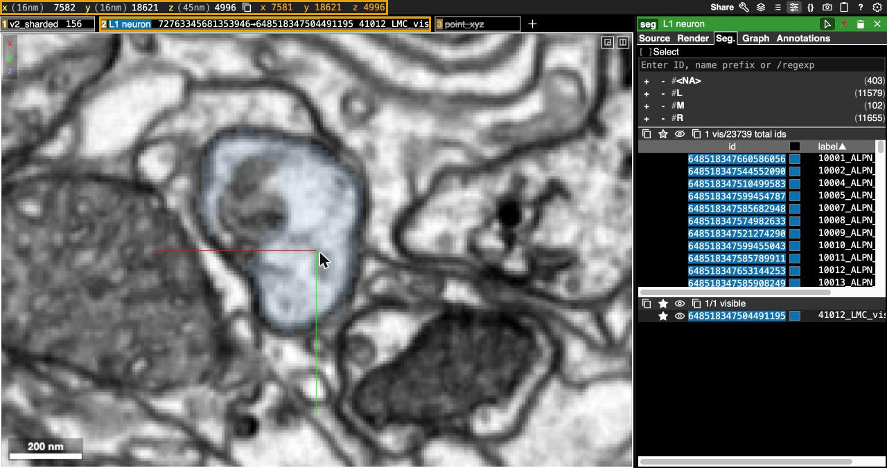
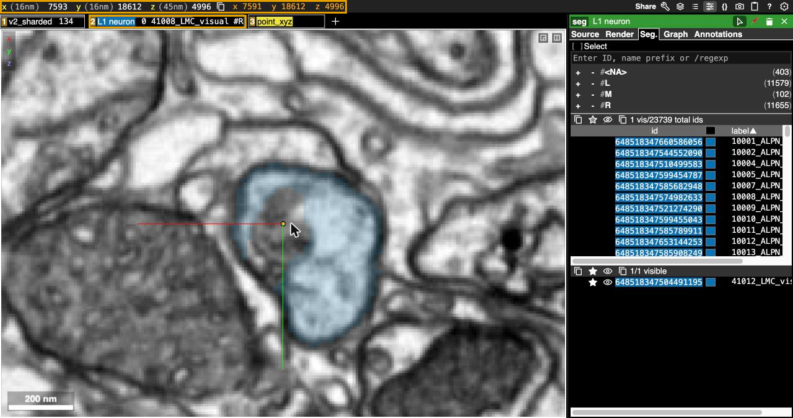

# Proofreading guide

## Overview

This page takes one cell from "I'd like to work on this" to "done and recorded". It is written for the optic lobe team, who track their cells in the optic lobe targets sheet as well as in SeaTable. As the [Code of Conduct](https://github.com/htem/faab/wiki/Code-of-Conduct) says, only make edits that are clearly correct. The Neuroglancer tools (merge, cleave, find path) are described in the [README](README#proofreading-functions).

## 1. Check SeaTable before you start

This keeps anyone from redoing a cell that someone else has finished or is working on.

1. **Get the cell's current root_id.** Open the row's xyz in Neuroglancer and read the segment ID there. Root IDs change with every edit, so the ID in the sheet or in an old link may be out of date.
2. **Search SeaTable for that root_id** in your own view, not by filtering the default view. SeaTable updates root_id from point_xyz about every 30 minutes, so a cell edited very recently may still be listed under its previous ID.
3. **Check the sheet as well.** The same cell may appear on other tabs. The SeaTable column says "present" (already in SeaTable) or "added" (our team added it).
4. **Decide:**
   - Not in SeaTable and not being worked on in the sheet: go ahead.
   - Someone else is listed as proofreader or annotator and the cell is not finished: message them on Slack before you edit it.
   - Already finished (SeaTable "adequate" or "complete", or "proofread" or "checked" in the sheet): don't redo it. If you think it needs more work, ask first.
   - Status "duplicate": ignore that row and use the remaining true row.

## 2. Claim it

In the sheet, set the row's status to **in progress** and add your name as proofreader, spelled the same way every time.

## 3. Proofread

- Make the clearly correct edits: merge the missing pieces and cleave the false merges.
- If you cleave a merge with someone else's neuron, add your initials to that neuron's proofreader column too. If it belongs to another group's project, send them a Slack message.
- If you can't attach a small fragment to anything, set its status to **stopped** and its note to "orphan fragment".

## 4. Keep the xyz on the cell

The xyz is the row's anchor. At each sheet update, root_id_curr is refreshed from the xyz, so a point off the cell attaches the row to the wrong neuron.

1. Choose a point on the main backbone, in a large profile, in **clear cytoplasm**: away from mitochondria, vesicle clusters, membranes, and the soma. A point on a mitochondrion maps to segment 0 (no neuron).
2. Pick it in a 2D slice panel, not in the 3D view (a click on the 3D mesh surface can land on a neighboring speck).
3. Right-click inside the cell's profile.
4. Click there and check that your neuron gets selected; hovering shows the segment ID, which should be the cell's root_id.
5. Copy the coordinates from the position readout at the top left (voxels) into xyz.

If the cell's ID changed, update the xyz. Don't type a new ID into root_id_curr.

When you fix something the sheet flagged (a yellow "xyz off the cell" row, a "missing soma" note), update the row: change the xyz, delete the note that is no longer true, and put your name and the date in. The update scripts remove flags they can confirm are fixed, but they can't read your mind.

## 5. Record it

- **Sheet:** set the status (**proofread** when done, **review** if you would like a second look), the pr_date, and a short note if needed (for example, "backbone seems fine"). Type dates year first (26-11-07), not day first.
- **Every change gets your name.** Whenever you change a row (status, xyz, notes), put your name in proofreader and the date in pr_date, even for a small change such as marking an orphan fragment "stopped". Unsigned changes can't be followed up.
- **SeaTable:** if the cell is missing, add it with the [minimal annotation](README#minimal-annotation); if it is there, update its status and add your initials as proofreader (and as annotator if you also labeled it). Then write "added" in the sheet's SeaTable column.
- **Checking:** the checker sets the status to **checked** and fills in chk_date and checker.

## Statuses in the sheet

| Status | Meaning |
|---|---|
| NEW | not started yet |
| in progress | someone is working on it (see proofreader) |
| review | proofread, but a second look is requested |
| proofread | finished by the proofreader |
| checked | finished and checked by a second person |
| adequate | SeaTable's status for a usable cell |
| stopped | work stopped, for example an orphan fragment that can't be attached |

Our "proofread" and "checked" both count as SeaTable "adequate" for now.

## Questions

When in doubt, ask: message David Hildebrand on Slack or post on #aedes-proofreading.
