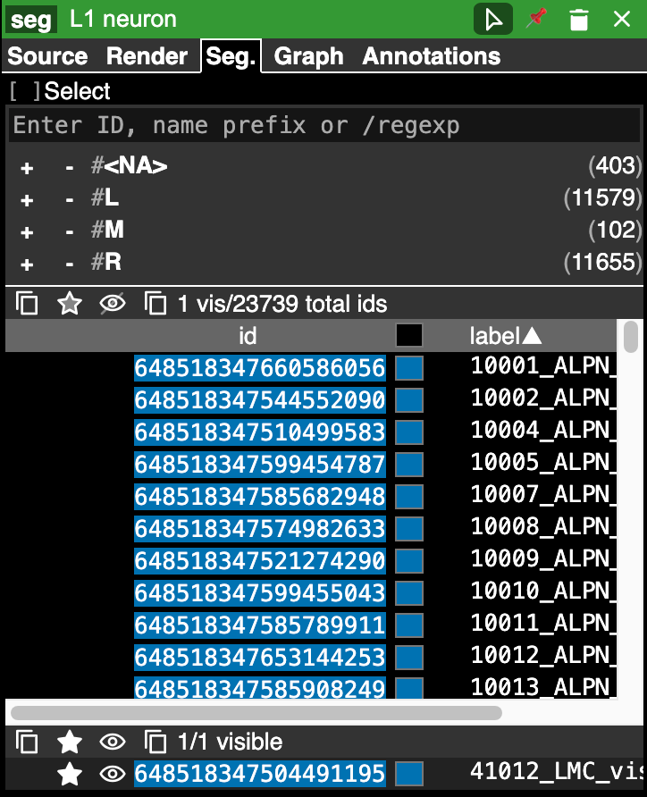
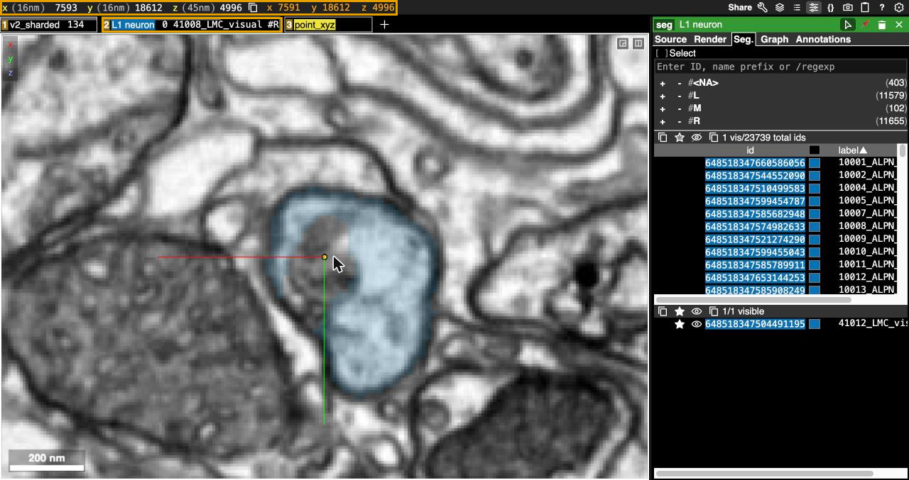
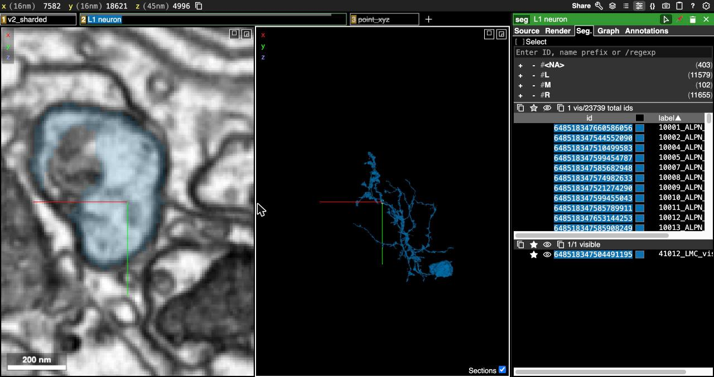

# README

## Overview

This page collects resources, links, and working rules for the Female Adult *Aedes aegypti* Brain (FAAB) dataset, acquired in Wei-Chung Allen Lee's lab (Harvard Medical School). Everyone who works in the dataset agrees to the [Code of Conduct](https://github.com/htem/faab/wiki/Code-of-Conduct). More will be added in due course.

| Resource | Link |
|---|---|
| Neuroglancer, latest production instance (with optic lobe neuropil meshes) | [Latest Instance](https://spelunker.cave-explorer.org/#!middleauth+https://global.daf-apis.com/nglstate/api/v1/5971265676902400) |
| Neuroglancer, original instance with tissue mesh | [Original Instance](https://spelunker.cave-explorer.org/#!middleauth+https://global.daf-apis.com/nglstate/api/v1/5009653548187648) |
| Left-right mirroring layer (Seba's mirroring transform) | [Mirroring Layer](https://spelunker.cave-explorer.org/#!middleauth+https://global.daf-apis.com/nglstate/api/v1/6739263583420416) |
| SeaTable (FlyTable) annotation table | [aedes table](https://flytable.mrc-lmb.cam.ac.uk/workspace/148/dtable/aedes/?tid=0000&vid=0000) |
| SeaTable Duplicates view | [Duplicates](https://flytable.mrc-lmb.cam.ac.uk/workspace/148/dtable/aedes/?tid=0000&vid=8yT4) |
| Proofreading guide | [Proofreading guide](Proofreading-guide) |
| SeaTable dos and don'ts | [SeaTable dos and don'ts](SeaTable-dos-and-donts) |
| Proofreader's guide to neurons (in progress) | [Guide](https://docs.google.com/document/d/1xbFBlLT3rlvjgG52jCsPeI7adD_VoXARBuOPCJpX-S8/edit?usp=sharing) |
| Dataset collaborators | [Aedes Users](https://docs.google.com/spreadsheets/d/1W0CLjIvgX9rl4ttqgjI3xr3zlL_hA86ZRW0-3-CGQTU/edit?usp=sharing) |

## Getting started

1. Read the [Code of Conduct](https://github.com/htem/faab/wiki/Code-of-Conduct) and turn on Slack notifications for direct messages and mentions.
2. If you have not proofread EM data before, complete the [FlyWire tutorial materials](https://github.com/jasper-tms/the-BANC-fly-connectome/wiki/Proofreading-training-materials) (courtesy of Jasper Phelps) and practice merging, finding paths, and cleaving in the FlyWire sandbox.
3. Ask for an interview to assess your readiness for the Aedes dataset: David Hildebrand (optic lobe collaborators), or Farzaan or Mohd Freezly (Freeze), on Slack.
4. Once you have passed the interview, ask Wei Lee for editing access to the production instance.
5. For SeaTable access, contact Greg Jefferis. Read the [SeaTable](#seatable) section below before you make any edit there, including changes to a view.
6. Use an external mouse with left and right buttons and a scroll wheel. Neuroglancer relies on right-clicks, scrolling, and control-scrolling, which are slow and error-prone on a trackpad.

## Neuroglancer

We use Neuroglancer (Spelunker) to view and proofread the neurons in this dataset.

### Orientation

**Important:** the brain volume (like FAFB) was flipped during imaging. Viewed from the front, the animal's actual left is on **your** left.

### Layers

| Layer | Contents |
|---|---|
| v2_sharded | 2D view of the EM volume |
| wclee_aedes_brain | automated segmentation for proofreading (neuron meshes) |
| brain_mesh | mesh surrounding the whole brain volume |
| aedes_neuropil | meshes surrounding synaptic neuropils (several versions in the Seg tab) |
| al_meshes | each glomerulus and the whole antennal lobes (as of 07/05/2026) |
| lh_meshes | lateral horns, based on ALPN outputs |
| mb_meshes | mushroom bodies |
| CX_mesh | central complex: fan-shaped body (Fx_c, hDelta), ellipsoid body (EPG, EPGt, PEG, PGE), protocerebral bridge (EPG, EPGt, PEG, PGE), noduli (LNO output), asymmetric body (SA output), bulb (TuBu), gall (EPG, EPGt, PEG, PGE), and assorted lateral complex (Fx) neuropil |

### Adding neurons to the view

- Paste root_id number(s) into the Seg tab of the wclee_aedes_brain layer to display them with their annotations.



- You can also retrieve sets of neurons by filtering for annotations.
- In the Source tab, near the bottom, you can edit which annotations are displayed (in curly brackets).

### Proofreading functions

- **Merge** pieces of the same neuron: press `m` to bring up the merge tool (lower left). Control-click in the 2D view to add one point in each of the two pieces, then select "submit". You can queue several merges before submitting.
- **Cleave** a merge error: press `c` to bring up the cleave tool. Control-click in the 2D or 3D view to add several points on one side of the split (one per supervoxel), press `g` to swap colors, and add several points on the other side. Then select "submit".
- **Find** the likely site of a merge error: press `f` to bring up "find path". Control-click in the 3D view on two points that you believe belong to different neurons, then select "submit" to see the path that connects them.
- **Regenerate** an edited neuron: after merges or cleaves, control-shift-click to refresh the neuron's mesh.

### Aedes symmetric space

- [Code from Sebastian Cachero](https://flyconnectome.slack.com/archives/C08JP39THMM/p1759143312091199)
- [Files for transforms](https://drive.google.com/drive/folders/1SGaaRn0knAyB3pCuhGSnGKvs8aObQrzX?usp=sharing)

## Proofreading

Proofreading is a skill, and mastery takes time. As the Code of Conduct says, focus on the "low-hanging fruit" and only make edits that are clearly correct. The [Proofreading guide](Proofreading-guide) walks through one cell from start to finish. The two steps that prevent most problems:

1. **Check SeaTable before you start on a cell,** so that nobody redoes a cell that someone else has finished or is working on. See [Checking whether a cell is already in SeaTable](#checking-whether-a-cell-is-already-in-seatable).
2. **Keep each cell's point on the cell.** See [Choosing point_xyz](#choosing-point_xyz).

If an orphan fragment can easily be merged into a glial cell (particularly one with a soma), merge it and add the glial cell to SeaTable with superclass "glia": this lets us exclude these synapses from some analyses and helps future studies of glia. See the [Proofreading guide](Proofreading-guide).

If you edit a neuron that belongs to another group's proofreading project (for example, by cleaving a false merge with your own neuron), add your initials to its proofreader column and send the relevant person(s) a Slack message.

## SeaTable

We use SeaTable (the FlyTable server) to annotate cell types and to keep track of who is working on what. It is shared, live data: every change you make, including changes to a shared view's sort order or filters, affects all other users immediately. SeaTable is powerful but not always user-friendly. For the short version, see [SeaTable dos and don'ts](SeaTable-dos-and-donts).

### Views

- Do **not** use the default view for sorting, filtering, or hiding columns.
- Create your own view instead: in the top left, add a folder with your name (or use your team's group, for example "TeamOL") and add views there with your filters, sort order, and hidden columns.
- A private view still shows everyone's shared data: edits made in it are edits for everyone.

### Checking whether a cell is already in SeaTable

Do this before you start on a cell and before you add a row.

1. Get the cell's **current** root_id in Neuroglancer, at the cell's point. Root IDs change every time a neuron is edited, so an ID from a spreadsheet or an old link may be out of date.
2. Search SeaTable for that root_id in your own view.
3. SeaTable updates root_id from point_xyz about every 30 minutes, so a cell edited very recently may still be listed under its previous ID. If you find nothing but the cell was just edited, check again later.
4. If the cell is there, read its status, proofreader, annotator, and notes. If someone else is listed and the cell is not finished, contact them before you edit it.

### Adding a cell by hand

1. Check that the cell is not already in SeaTable (above): search for its current root_id.
2. Add a new row at the bottom of the **unfiltered** table.
3. Fill in at least the [minimal annotation](#minimal-annotation).
4. Leave root_id, serial_id, and supervoxel_id **blank**: the scripts fill them in from point_xyz about every 30 minutes.
5. Don't leave empty rows. An empty row uses up a serial_id (we want to keep these numbers small) and counts as a bad supervoxel row, which causes glitches in downstream analysis. If you add one by accident, delete it.

### Minimal annotation

Every new row should have:

- **point_xyz** on the backbone, in clear cytoplasm (see [Choosing point_xyz](#choosing-point_xyz))
- **side**
- **superclass**
- **status**
- **annotator** (your initials), and **proofreader** as well if you also merged or cleaved the neuron.

SeaTable and the update scripts then fill in supervoxel_id (from point_xyz), root_id (from supervoxel_id), and serial_id.

### Choosing point_xyz

point_xyz is the cell's anchor: supervoxel_id and root_id are derived from it, so a point that misses the cell attaches the row to the wrong neuron, and a point on unsegmented tissue attaches it to no neuron at all.

1. Choose a point on the main backbone, in a large profile (near the branch that leads to the soma tract, if known).
2. Put it in **clear cytoplasm**: away from mitochondria, vesicle clusters, membranes, and the soma. Mitochondria are often left out of the neuron's segmentation, so a point on one maps to segment 0, and SeaTable then cannot fill in supervoxel_id or root_id (both stay 0).
3. Pick it in a 2D slice panel, not in the 3D view: a click on the 3D mesh surface can land on a neighboring speck.
4. Right-click inside the cell's profile in the 2D panel to move the position there.
5. Before you save, click at that spot and check that your neuron gets selected. Hovering shows the segment ID, which should be the cell's root_id.
6. Copy the position: click the copy button (two overlapping squares) just to the right of the x, y, z readout at the top left. That puts the coordinates (in voxels) on your clipboard. Paste them into point_xyz.







The **bad supervoxel** view in SeaTable lists every row whose point maps to no segment. Check it now and then.

[aedes_key_point()](https://flyconnectome.github.io/aedes/reference/aedes_key_point.html) chooses good points automatically and is wrapped by [aedes_add_neurons()](https://flyconnectome.github.io/aedes/reference/aedes_add_neurons.html).

### Changing someone else's entry

- In general, contact the person who added or annotated a neuron before you change or add to their annotations.
- It is fine to edit without asking if you are the expert for that neuron's type or population and the other user worked on it incidentally (for example, while seeding a tract), or if you have found a feature with high confidence that clearly changes the annotation.
- Either way, add your initials to the annotator column. If you merged or cleaved the neuron, add your initials to the proofreader column.
- Working groups may ask for specific neurons or populations to be protected from changes by other users when they begin manuscript preparation.

### Duplicates

Each reconstructed neuron should occupy one row. Before adding a new row, check whether the root_id is already in the table, and regularly check the [Duplicates view](https://flytable.mrc-lmb.cam.ac.uk/workspace/148/dtable/aedes/?tid=0000&vid=8yT4), where rows with the same root_id appear together. A row whose point was fixed can turn out to be a duplicate: once the point is on the neuron, it resolves to the neuron's root_id, which may already have a row.

- **Both rows are yours:** cross-check the annotations, keep the better row, and delete the other.
- **The rows came from different people or efforts:** set status = "duplicate" on all but one, move their annotations to the remaining row as appropriate, and check that its point_xyz is on the neuron's backbone. Rows with status = "duplicate" can then be deleted.

### Statuses

| Status | Meaning |
|---|---|
| to_review | the default, before proofreading |
| adequate | proofread to a usable standard |
| needs_extending | the neuron needs extending |
| merge_error | the neuron needs a cleave |
| complete | only for neurons judged entirely finished |
| duplicate | a repeated row (ignore it) |

### Columns

| Column | Contents |
|---|---|
| supervoxel_id | an invariant supervoxel of the neuron, updated every 30 minutes from point_xyz |
| root_id | the current ID of the neuron (changes with every edit), updated every 30 minutes from point_xyz |
| serial_id | a short sequential ID, assigned automatically |
| point_xyz | an invariant position on the neuron (see [Choosing point_xyz](#choosing-point_xyz)) |
| root_duplicated | checked when the same neuron appears more than once |
| side | side of the soma (if known) or of the entry point (sensory and ascending neurons). Note the [orientation](#orientation) |
| group | the lowest serial_id of a pair or larger set of homologous neurons. Neurons matched across sides share a group |
| type | the neuron's name in this dataset. All neurons of a group share a type |
| superclass | broadest class: cb_intrinsic, ol_intrinsic, ascending_neuron, descending_neuron, cb_sensory, ol_sensory, or cb_motor |
| neuropils | main neuropil(s) innervated: AMMC, AL, CX, GNG, LH, LO, ME, MB, SLP, SMP, or TBD ([nomenclature](https://www.sciencedirect.com/science/article/pii/S0896627313011781?via%3Dihub)) |
| axon_tract | main axon tract, for example mALT or lALT |
| hemilineage | developmental origin, where known or inferred |
| class | second level, for example ALPN or ALLN, or DNa, DNb, and so on for descending neurons |
| subclass | third level, with rules that vary by superclass. Central brain intrinsic neurons: IR (ipsilateral to the soma, one neuropil), BR (bilateral, one neuropil), CR (contralateral, one neuropil), II (ipsilateral, two neuropils), BI (bilateral, two neuropils), and CI (contralateral, two neuropils), with more detail where useful, for example II_UNI / II_MUL for uniglomerular / multiglomerular ALPNs |
| subsubclass | currently glomerulus number(s), but may be used for other purposes for other neurons |
| notes | comments from annotators and proofreaders: prefix with your initials and separate entries with semicolons |
| annotator | who labeled and annotated the neuron (if you did both this and the proofreading, put your initials in both columns) |
| status | proofreading status (see [Statuses](#statuses)) |
| proofreader | who merged or cleaved the neuron in Neuroglancer (not who annotated it) |
| soma_xyz | soma coordinates, when the soma cannot be connected |
| birthtime | "early" (larger soma, more elaborate, likely unique per side) or "late" (likely one of a population of similar neurons) |
| nerve | nerve through which a sensory neuron enters or an efferent / motor neuron exits |
| synonyms | names for this type in the literature, with references |
| flywire_type | the type in the FlyWire FAFB dataset, for neurons matched to *Drosophila* homologs |
| receptor | for example, the olfactory or gustatory receptor expressed, where known |
| instance | please ignore for now |
| lrcid | left-right clustering ID, for example C002:001 (the 1st neuron of the 2nd clustering run, LR NBLAST for PNs) or C010:1000 (the 1000th neuron of the 10th run, by connectivity for ORNs) |

### Reading and writing many rows

- **Writing:** do not use the web interface to change more than a handful of rows at a time, because the sort order and the set of rows can change while you work. Bulk uploads and changes are done programmatically, with great care: discuss them on #aedes-proofreading first (unless you already have significant experience), do a dry run, and work alongside someone who can sense-check. We recommend that each group designate one person to do bulk uploads from working spreadsheets. Greg Jefferis's code for this is documented at [aedes_add_neurons](https://flyconnectome.github.io/aedes/reference/aedes_add_neurons.html).
- **Reading:** for offline use (consistent with the Code of Conduct), download programmatically. The web spreadsheet download is unreliable now that the table is large. In R:

```r
library(aedes)
am <- aedes_meta()
# to keep bad / duplicate rows as well
am <- aedes_meta(drop_status = NULL)
write.csv(am, "aedes_meta.csv")
arrow::write_feather(am, "aedes_meta.feather")
```

## Programmatic access

- **R:** the [aedes package](https://flyconnectome.github.io/aedes/).
- **Python:** CAVE (caveclient), with a token from <https://global.daf-apis.com/auth/api/v1/user/token>.
- A private [GitHub repository](https://github.com/flyconnectome/2025aedes) holds scripts, functions, and other artifacts for analysis and eventual publication. Contact Greg Jefferis for access.

## Guides and resources

- [Proofreader's guide to neurons](https://docs.google.com/document/d/1xbFBlLT3rlvjgG52jCsPeI7adD_VoXARBuOPCJpX-S8/edit?usp=sharing) (in progress): identifying specific classes of neurons. Contact Lisa Marin (Cambridge) to contribute a section.
- [Dataset collaborators](https://docs.google.com/spreadsheets/d/1W0CLjIvgX9rl4ttqgjI3xr3zlL_hA86ZRW0-3-CGQTU/edit?usp=sharing)
- [BANC Proofreading 101](https://blog.flywire.ai/2024/12/20/banc-proofreading-101-climb-into-spelunker/#ib-toc-anchor-4)
- [A Systematic Nomenclature for the Insect Brain](https://pubmed.ncbi.nlm.nih.gov/24559671/)

## Amendments

This page will change as the project develops. To suggest additions or corrections, contact the Steering Committee or post on Slack.
